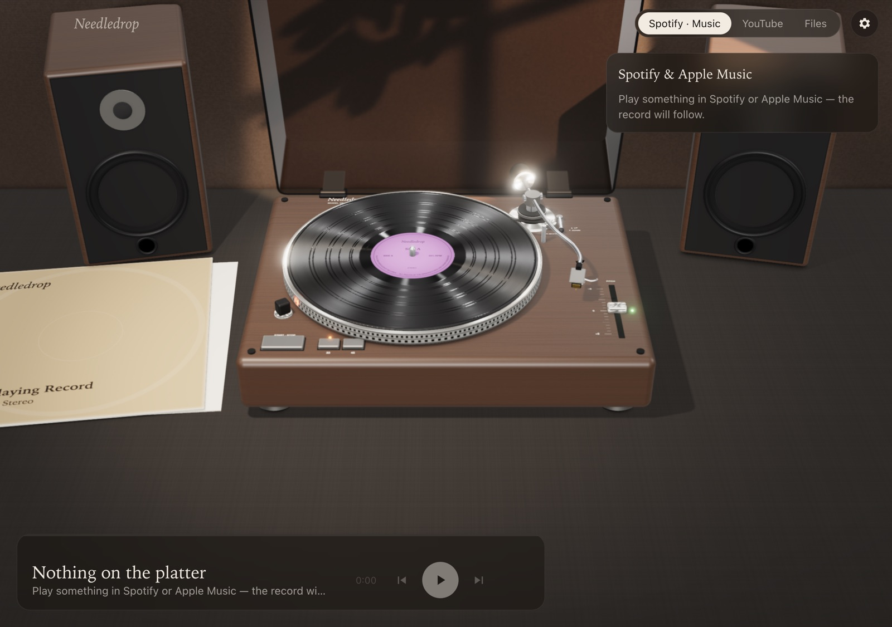

# Needledrop



A real-time 3D turntable for your desktop. Whatever you're listening to gets pressed onto a record, the platter spins up, and the tonearm tracks across the grooves as the song plays. Built with [three.js](https://threejs.org) and Electron. No models, samples or images are bundled: the turntable, grooves, label, sheen and surface noise are all generated in code.

## Features

Every part of the deck either works or is there because a real direct-drive turntable has it for a reason.

- **The record is physically shaded.** An anisotropy map runs along the grooves, so light fans out radially across the vinyl the way it does on a real LP. Track gaps are glossier bands, the dead wax carries a hand-etched matrix number, the edge has a raised bead, and the paper label is matte.
- **The album art is printed twice:** on the record label and on the jacket lying on the table beside the deck, with ring wear and an inner sleeve slipping out. Click the sleeve to change the record.
- **The tonearm is an S-shaped arm.** It has a gimbal bearing, an offset headshell with finger lift, a cartridge and cantilever, a counterweight with a tracking-force scale, an anti-skate dial and a rubber arm rest.
  - Press play and it lifts, swings to the lead-in and lowers on a damped cue; the audio starts when the needle lands.
  - It moves inward as the track plays.
  - Drag it anywhere on the record to seek.
- **Cue lever:** a real lever and platform. Clicking it raises the platform under the arm tube and lifts the needle.
- **Start/stop, 33 and 45:** labelled caps that press down, with speed LEDs. Hover any control on the deck to see what it does.
- **Target light:** a pop-up lamp beside the platter lights the needle, so you can cue in a dark room.
- **Pitch slider (±8 %):** it changes the platter speed and the playback rate of local files and YouTube. A green quartz-lock light glows only at exactly 0.
- **Strobe lamp and dots:** the lamp lights the strobe dots on the platter rim. Their apparent drift is computed from the real speed: at exactly 33⅓ the 33 row stands still, and the 45 row drifts.
- **Dust cover:** one moulded smoked-acrylic shell that refracts and tints what's behind it, on friction hinges, with rubber bumpers and a thumbprint where you'd lift it. Click it to open or close.
- **Speakers that move with the music:** walnut bookshelf speakers whose woofer cones and tweeter domes respond to what's actually playing. They hear YouTube and local files on every platform, and everything on Windows. On macOS and Linux, Spotify and other players run in their own apps, which Needledrop can't hear, so the speakers stay still rather than fake it.
- **Video on a stand:** YouTube video plays on a tablet in a walnut stand beside the deck, and it's properly hidden when the deck passes in front of it.
- **Desktop widgets:**
  - **Turntable:** the same 3D deck, floating on your desktop with just its shadow. Drag an edge to resize it; it keeps its proportions and remembers its size and position. The tonearm, start/stop, cue lever, 33/45 and pitch all work and control the main window. Drag empty space to move it, double-click to open Needledrop, and hover for × to close it.
  - **Now-playing strip:** a small spinning record with the title and transport, in frosted glass tinted from the album art.
  - Both float on top by default, or can sit with your other windows.
- **Surface noise:** hiss and pops, a thump on needle drop and a click on lift, all synthesised with Web Audio.
- **Room:** a linen-covered sideboard against a plaster wall, with late-afternoon window light and leaf shadows falling across it, soft depth of field, and ambient occlusion for contact shadows. Pick an evening or a daylight room in Settings; the deck finish never changes the room.
- **Five finishes:** walnut, light oak, matte black, chalk white and blush.
- **Opens your audio files:** double-click an MP3, M4A, FLAC, WAV, OGG, AIFF or Opus file, use *Open With*, or drop files on the Dock icon, and it goes straight onto the platter. To make Needledrop the default for a file type on macOS, select a file in Finder, choose **File → Get Info → Open with → Needledrop**, then **Change All…**.
- **Volume and media keys:** a volume slider for YouTube and local files (or ↑ ↓), and your keyboard's play/next keys plus Control Center work for what Needledrop is playing.
- **Your sideboard, your call:** turn the speakers, the video stand and the album sleeve on or off in Settings → On the sideboard.
- **Desktop:** keep-on-top and a compact mode.

## Music sources

| Source | How it works | Setup |
|---|---|---|
| **Now playing: macOS** | Spotify and Apple Music, read and controlled over AppleScript: track, position, artwork, play/pause/seek/skip. | None. macOS asks once for permission to control each app. |
| **Now playing: Windows** | The system media session, the same one the volume flyout shows, so Spotify, browsers and most players. Read through WinRT. | None |
| **Now playing: Linux** | Any MPRIS player, such as Spotify, Rhythmbox or VLC, via `playerctl`. | `playerctl` (the `.deb` installs it) |
| **YouTube** | Official IFrame Player API. Paste a video or playlist link. *Show video* reveals the player. | None |
| **Local files** | Drag audio files onto the window or use *Add files*. Tags and embedded artwork are read with `music-metadata`. | None |

## Install

Download from [Releases](https://github.com/TheSscarletSkies/needledrop/releases/latest):

- **macOS:** the `.dmg` for your Mac (`arm64` for Apple Silicon, the other for Intel). Open it and drag **Needledrop** into Applications. The builds aren't notarized yet, so the first time you open it, right-click the app and choose **Open**. The first time it reads Spotify or Music, macOS asks whether Needledrop may control that app; say yes, or the record won't follow along.
- **Windows:** `Needledrop-Setup-…-x64.exe` (or `arm64`). It isn't code-signed yet, so SmartScreen may warn you; choose **More info → Run anyway**.
- **Linux:** the `.deb` for Debian or Ubuntu, or the `.AppImage` for anything else (`chmod +x` it first). For the AppImage, install `playerctl` yourself so Needledrop can see your music player.

## Run it from source

```bash
npm install
npm run dev     # Electron app with hot reload
npm run web     # browser-only (YouTube + local files; no Spotify/Music bridge)
npm run dist:mac    # release.noindex/*.dmg and *.zip for Apple Silicon and Intel
                    # (.noindex keeps Spotlight from listing build copies of the app)
npm run dist:win    # Windows installer (build on Windows)
npm run dist:linux  # AppImage and .deb (build on Linux)
```

Pushing a tag like `v0.2.0` builds all three on GitHub Actions and attaches them to a draft release (`.github/workflows/release.yml`).

### Controls

| | |
|---|---|
| Drag the tonearm | Seek / start / stop |
| START · STOP button | Start / stop |
| Cue lever | Lift / lower the needle |
| 33 / 45 buttons, pitch slider | Speed |
| Dust cover | Click to open / close |
| Album jacket | Click to change the record |
| Double-click empty space | Reset the view |
| Drag empty space | Orbit the camera; scroll to zoom |
| `Space` | Play / pause |
| `←` `→` | Seek ±10 s |
| `↑` `↓` | Volume |
| `N` / `P` | Next / previous |

## Project layout

```
electron/
  main.js          window, local http server (YouTube embeds need an http origin), IPC
  nowplaying*.js   what's playing: AppleScript (macOS), WinRT media session (Windows), playerctl (Linux)
  widgets.js       the desktop widget windows
  preload.cjs      the window.needledrop API exposed to the renderer
src/
  main.js          app controller: sources ↔ scene, transport, input, settings
  scene/turntable.js  geometry, tonearm kinematics, cueing state machine
  scene/textures.js   procedural grooves, label, wood grain, strobe, sleeve, lid surface
  scene/room.js       wall and window light
  scene/speakers.js   bookshelf speakers
  scene/videoStand.js tablet stand for YouTube video
  widget.js           the desktop widgets (2D canvas)
  sources/         system.js, youtube.js, local.js (one shared interface)
  audio/crackle.js synthesised surface noise and needle sounds
  audio/levels.js  listens to playback so the speakers can move
```

### Adding a source

A source is an object with `poll() → { track, position, duration, playing }` plus `play()`, `pause()`, `seek(sec)`, `next()` and `prev()`. `track` needs `id`, `album` (a key used to decide when to press a new record), `title`, `artist` and `art` (URL or data URL). Register it in `src/main.js` and add a tab in `index.html`.

## Roadmap ideas

- Code signing and notarization
- More finishes, picture discs and coloured splatter pressings
- Album-art thumbnails from the Windows media session

## Security

Needledrop's windows only ever show its own pages:
- navigation away is blocked
- links open in your browser, and only if they're ordinary `https` links
- every permission is denied (camera, microphone, notifications, location…) except capturing the app's own audio for the speakers
- the YouTube player is a sandboxed cross-origin iframe with no access to the app

File access through the app is limited to audio files you open and cover-art images. Report security issues privately through GitHub's *Report a vulnerability*.

## Credits

Inspired by the turntable apps *MD Vinyl* and *Vinyl for Mac*. Needledrop is an independent project, not affiliated with either, and shares no code or assets with them.

## License

MIT
